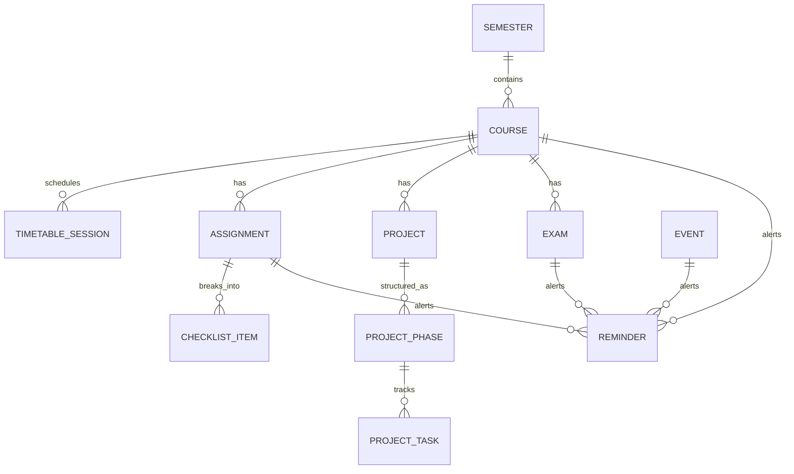

# CampusLife — Local Database Schema (Drift / SQLite)

CampusLife is a 100% offline-first, privacy-focused academic productivity application. All data is persisted locally in an on-device SQLite database managed through the **Drift** (formerly Moor) reactive persistence library for Dart & Flutter.

There is **no backend, no cloud synchronization, and no user tracking**.

---

## 1. Entity Relationship Diagram (ERD)



---

## 2. Table Specifications

### 2.1 `semesters`
Represents an academic term (e.g., Fall 2026 / نیم‌سال اول ۱۴۰۵-۱۴۰۶). Only one semester is marked as active (`is_archived = false`) at any given time.

| Column | Type | Constraints | Description |
|---|---|---|---|
| `id` | INTEGER | PRIMARY KEY AUTOINCREMENT | Unique identifier |
| `title` | TEXT | NOT NULL | e.g., "نیم‌سال اول ۱۴۰۵-۱۴۰۶" / "Fall 2026" |
| `start_date` | INTEGER | NOT NULL | Unix epoch millisecond timestamp |
| `end_date` | INTEGER | NOT NULL | Unix epoch millisecond timestamp |
| `is_archived` | BOOLEAN | NOT NULL DEFAULT FALSE | True when semester is finalized & archived |
| `gpa` | REAL | NULL | Calculated term GPA (e.g., 18.45 / 4.0) |
| `total_credits` | INTEGER | NOT NULL DEFAULT 0 | Total registered credits |
| `created_at` | INTEGER | NOT NULL | Timestamp |

### 2.2 `courses`
Academic subjects taken within a semester.

| Column | Type | Constraints | Description |
|---|---|---|---|
| `id` | INTEGER | PRIMARY KEY AUTOINCREMENT | Unique identifier |
| `semester_id` | INTEGER | NOT NULL REFERENCES semesters(id) ON DELETE CASCADE | Parent semester |
| `title` | TEXT | NOT NULL | e.g., "ساختمان داده‌ها و الگوریتم‌ها" |
| `code` | TEXT | NOT NULL | e.g., "CE204" |
| `instructor` | TEXT | NOT NULL | Instructor name |
| `credits` | INTEGER | NOT NULL DEFAULT 3 | Credit units (1 to 6) |
| `color_hex` | TEXT | NOT NULL | UI accent color (e.g. `#2563EB`) |
| `default_room` | TEXT | NULL | Default classroom name |
| `created_at` | INTEGER | NOT NULL | Creation timestamp |

### 2.3 `timetable_sessions`
Weekly recurring class meeting times.

| Column | Type | Constraints | Description |
|---|---|---|---|
| `id` | INTEGER | PRIMARY KEY AUTOINCREMENT | Unique identifier |
| `course_id` | INTEGER | NOT NULL REFERENCES courses(id) ON DELETE CASCADE | Associated course |
| `day_of_week` | INTEGER | NOT NULL | 1=Saturday ... 7=Friday (Persian) / 1=Mon..7=Sun |
| `start_time` | TEXT | NOT NULL | Format: "08:00" |
| `end_time` | TEXT | NOT NULL | Format: "10:00" |
| `classroom` | TEXT | NOT NULL | Room name or hall |
| `repeat_weekly`| BOOLEAN | NOT NULL DEFAULT TRUE | Weekly recurrence flag |

### 2.4 `assignments`
Course homework and assignments with question checklists and deadline extensions.

| Column | Type | Constraints | Description |
|---|---|---|---|
| `id` | INTEGER | PRIMARY KEY AUTOINCREMENT | Unique identifier |
| `course_id` | INTEGER | NOT NULL REFERENCES courses(id) ON DELETE CASCADE | Associated course |
| `title` | TEXT | NOT NULL | e.g., "تمرین ۳: درخت‌های AVL" |
| `description` | TEXT | NULL | Detailed instructions |
| `original_deadline` | INTEGER | NOT NULL | Initial due date timestamp |
| `extended_deadline` | INTEGER | NULL | Extended due date timestamp |
| `extension_reason` | TEXT | NULL | Reason for extension |
| `is_completed` | BOOLEAN | NOT NULL DEFAULT FALSE | True when turned in |
| `created_at` | INTEGER | NOT NULL | Timestamp |

> [!NOTE]
> **Computed Status Rule**: Status is dynamically derived at runtime:
> - `Completed`: `is_completed == true`
> - `Overdue`: `is_completed == false AND currentTime > (extended_deadline ?? original_deadline)`
> - `Extended`: `is_completed == false AND extended_deadline != null AND currentTime <= extended_deadline`
> - `In Progress`: `is_completed == false AND some checklist items checked`
> - `Not Started`: `is_completed == false AND no checklist items checked`

### 2.5 `checklist_items`
Sub-questions or tasks within an assignment.

| Column | Type | Constraints | Description |
|---|---|---|---|
| `id` | INTEGER | PRIMARY KEY AUTOINCREMENT | Unique identifier |
| `assignment_id` | INTEGER | NOT NULL REFERENCES assignments(id) ON DELETE CASCADE | Parent assignment |
| `title` | TEXT | NOT NULL | e.g., "سوال ۱: پیاده‌سازی درخت BST" |
| `is_done` | BOOLEAN | NOT NULL DEFAULT FALSE | Checklist state |
| `sort_order` | INTEGER | NOT NULL DEFAULT 0 | Display sequence |

### 2.6 `projects`
Multi-phase term projects.

| Column | Type | Constraints | Description |
|---|---|---|---|
| `id` | INTEGER | PRIMARY KEY AUTOINCREMENT | Unique identifier |
| `course_id` | INTEGER | NOT NULL REFERENCES courses(id) ON DELETE CASCADE | Associated course |
| `title` | TEXT | NOT NULL | Project title |
| `description` | TEXT | NULL | Project brief |
| `created_at` | INTEGER | NOT NULL | Timestamp |

### 2.7 `project_phases`
Milestones and sequential phases for a project.

| Column | Type | Constraints | Description |
|---|---|---|---|
| `id` | INTEGER | PRIMARY KEY AUTOINCREMENT | Unique identifier |
| `project_id` | INTEGER | NOT NULL REFERENCES projects(id) ON DELETE CASCADE | Parent project |
| `phase_number` | INTEGER | NOT NULL | e.g. 1, 2, 3 |
| `title` | TEXT | NOT NULL | e.g., "فاز ۱: معماری پایه" |
| `deadline` | INTEGER | NOT NULL | Phase milestone deadline timestamp |
| `is_completed` | BOOLEAN | NOT NULL DEFAULT FALSE | Completion status |

### 2.8 `project_tasks`
Actionable task checklist items under each project phase.

| Column | Type | Constraints | Description |
|---|---|---|---|
| `id` | INTEGER | PRIMARY KEY AUTOINCREMENT | Unique identifier |
| `phase_id` | INTEGER | NOT NULL REFERENCES project_phases(id) ON DELETE CASCADE | Parent phase |
| `title` | TEXT | NOT NULL | Task description |
| `is_completed` | BOOLEAN | NOT NULL DEFAULT FALSE | Task state |

### 2.9 `exams`
Midterm exams, final exams, and quizzes.

| Column | Type | Constraints | Description |
|---|---|---|---|
| `id` | INTEGER | PRIMARY KEY AUTOINCREMENT | Unique identifier |
| `course_id` | INTEGER | NOT NULL REFERENCES courses(id) ON DELETE CASCADE | Associated course |
| `exam_type` | TEXT | NOT NULL | 'midterm' \| 'final' \| 'quiz' |
| `exam_date` | INTEGER | NOT NULL | Exam timestamp |
| `classroom` | TEXT | NOT NULL | Exam hall / location |
| `seat_number` | TEXT | NULL | Assigned seat number |
| `topics` | TEXT | NULL | Comma-separated or JSON list of study topics |
| `prep_percent` | INTEGER | NOT NULL DEFAULT 0 | 0% to 100% study progress slider |

### 2.10 `events`
University and personal events.

| Column | Type | Constraints | Description |
|---|---|---|---|
| `id` | INTEGER | PRIMARY KEY AUTOINCREMENT | Unique identifier |
| `title` | TEXT | NOT NULL | Event name |
| `category` | TEXT | NOT NULL | 'academic' \| 'workshop' \| 'seminar' \| 'cultural' \| 'sports' \| 'personal' \| 'other' |
| `event_date` | INTEGER | NOT NULL | Event date/time |
| `location` | TEXT | NOT NULL | Venue or link |
| `has_reminder`| BOOLEAN | NOT NULL DEFAULT FALSE | Alarm toggle |
| `organizer` | TEXT | NULL | Hosting organization |

---

## 3. Data Export & Backup Format (JSON)

When the user taps **"پشتیبان‌گیری (Export JSON)"**, the app serializes the database into a clean, human-readable JSON payload:

```json
{
  "app": "CampusLife",
  "version": "1.0.0",
  "exportedAt": "2026-11-09T12:02:28Z",
  "semesters": [
    {
      "id": 1,
      "title": "نیم‌سال اول ۱۴۰۵-۱۴۰۶",
      "startDate": 1788739200000,
      "endDate": 1798761600000,
      "isArchived": false,
      "courses": [
        {
          "id": 1,
          "title": "ساختمان داده‌ها و الگوریتم‌ها",
          "code": "CE204",
          "instructor": "دکتر علیرضا محمدی",
          "credits": 3,
          "colorHex": "#2563EB",
          "sessions": [
            { "dayOfWeek": 1, "startTime": "08:00", "endTime": "10:00", "classroom": "۱۰۲ مهندسی" },
            { "dayOfWeek": 3, "startTime": "08:00", "endTime": "10:00", "classroom": "۱۰۲ مهندسی" }
          ],
          "assignments": [
            {
              "title": "تمرین ۳: درخت‌های AVL",
              "originalDeadline": 1794268799000,
              "extendedDeadline": 1794527999000,
              "isCompleted": false,
              "checklist": [
                { "title": "سوال ۱: درج و حذف در BST", "isDone": true },
                { "title": "سوال ۲: پیمایش‌های درخت", "isDone": true },
                { "title": "سوال ۳: پیاده‌سازی چرخش AVL", "isDone": false }
              ]
            }
          ]
        }
      ]
    }
  ]
}
```
